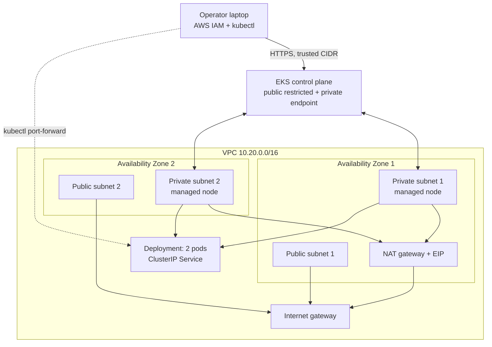

# AWS EKS Infrastructure Automation Using Terraform

A learning-focused DevOps portfolio project that provisions a two-AZ AWS network, an Amazon EKS cluster, and a private managed node group. Infrastructure and application deployment are deliberately separate: Terraform creates AWS resources; `kubectl` deploys a small unprivileged NGINX workload afterward.

> **Status:** implemented locally, not deployed. No AWS resources or deployment evidence are claimed.

## Architecture

The default region is `us-east-1`, but it is configurable. A single NAT gateway keeps the lab understandable and less expensive than one per AZ; it is a deliberate availability and cross-AZ-cost tradeoff. See [architecture details](docs/architecture.md).



## Prerequisites

- Terraform `>= 1.10, < 2.0`
- AWS CLI v2 and authenticated AWS profile/temporary credentials
- `kubectl` compatible with the selected Kubernetes version
- Bash and `curl`
- Recommended: Git, TFLint, Trivy, ShellCheck, kubeconform, Docker

Run `bash scripts/prerequisites.sh`. On the inspected Windows host, Terraform 1.15.6, kubectl 1.34.1, and Docker 29.1.5 were found; AWS CLI, Git, TFLint, Trivy, ShellCheck, and kubeconform were not on `PATH`.

## Repository

```text
terraform/              Root configuration and networking/EKS modules
kubernetes/             Namespace, Deployment, and ClusterIP Service
scripts/                Validation, kubeconfig, deploy, verify, cleanup helpers
docs/                   Architecture, troubleshooting, cost, and evidence notes
```

## Configure

```bash
cp terraform/terraform.tfvars.example terraform/terraform.tfvars
```

At minimum, set `administrator_principal_arn` to a stable IAM user or role ARN (not an STS session ARN). If `public_endpoint_access = true`, replace the example documentation address with your current trusted `/32`; `0.0.0.0/0` is rejected. With a private-only endpoint, run `kubectl` from a host with network reachability into the VPC.

Key variables include region, VPC/subnet CIDRs, Kubernetes version, endpoint access, log retention, instance types, disk size, and node group min/desired/max. Verify the selected EKS version exists in the target region immediately before planning.

## Validate and Deploy

The helper never applies infrastructure:

```bash
bash scripts/validate.sh
aws sts get-caller-identity --profile YOUR_PROFILE
terraform -chdir=terraform init
terraform -chdir=terraform plan -out=eks.tfplan
terraform -chdir=terraform show eks.tfplan
```

Confirm the account, region, resources, endpoint CIDRs, administrator ARN, and cost before continuing. Only after explicit authorization:

```bash
terraform -chdir=terraform apply eks.tfplan
export AWS_PROFILE=YOUR_PROFILE
bash scripts/configure-kubeconfig.sh
export KUBECONFIG="$PWD/.kube/config"
kubectl get nodes
bash scripts/deploy-app.sh
bash scripts/verify.sh
```

For interactive access, run `kubectl -n portfolio-app port-forward service/hello-app 8080:80` and open `http://127.0.0.1:8080`. The application is not publicly exposed.

## Security Decisions

- Nodes use private subnets and receive no public IP addresses or SSH configuration.
- The EKS private API endpoint is always enabled; public access is off by default and requires explicit non-worldwide CIDRs.
- EKS API access entries grant the supplied IAM principal the managed cluster-admin access policy; creator bootstrap admin is disabled.
- AWS IAM authenticates the caller and authorizes AWS/EKS API actions; EKS access policies/Kubernetes RBAC authorize Kubernetes API actions.
- All control-plane log types are enabled with 30-day default retention.
- Pods run non-root with a read-only root filesystem, dropped Linux capabilities, seccomp, no service-account token, and resource limits.
- The node role currently carries the CNI policy for simplicity. A production evolution should use EKS Pod Identity or IRSA for the VPC CNI and remove it from the node role.

## State

Initial local state is intentional and ignored by Git. It is sensitive and must not be shared. For collaboration, create a separately bootstrapped, versioned, encrypted, access-restricted S3 bucket and migrate using a partial backend configuration. Current Terraform supports S3 lockfiles with `use_lockfile = true`; DynamoDB locking is deprecated. Backend blocks cannot use normal Terraform input variables. Never commit backend credentials, state, or saved plans.

## Cleanup

Delete Kubernetes objects before destroying infrastructure, then review the destroy plan:

```bash
bash scripts/cleanup-app.sh
terraform -chdir=terraform plan -destroy -out=destroy.tfplan
terraform -chdir=terraform show destroy.tfplan
# Only after explicit authorization:
terraform -chdir=terraform apply destroy.tfplan
```

Check the AWS account afterward for project-tagged load balancers, NAT gateways, EBS volumes, Elastic IPs, ENIs, CloudWatch log groups, and other retained resources. Stopping or reducing nodes does not stop EKS control-plane, NAT, IPv4, logging, or storage charges.

## Costs and Limits

Recurring categories include the EKS control plane, EC2 nodes, EBS, NAT gateway hourly/data processing, its public IPv4 address, logs, and data transfer. This is not presented as free-tier eligible. See [cost and cleanup](docs/cost-and-cleanup.md). The single NAT gateway is a single-AZ failure dependency, and traffic from the other AZ can incur cross-AZ charges. Removing NAT requires an intentionally designed set of VPC endpoints and/or other egress path.

Node group size limits only constrain managed scaling; they do **not** install Cluster Autoscaler or Karpenter. Capacity and quota errors may require a different instance type, more allowed types, another AZ/region, or a quota increase.

## Interview Talking Points

Be ready to explain public versus private subnets; IGW versus NAT routing; control plane versus worker nodes; IAM authentication versus Kubernetes authorization; state and locking; plan versus apply; Deployment versus Service; why min/max values do not cause autoscaling; and the troubleshooting paths in [troubleshooting](docs/troubleshooting.md).

## Known Limitations

- One NAT gateway favors learning cost over multi-AZ egress resilience.
- No autoscaler, ingress controller, secrets manager integration, or application CI/CD is installed.
- Add-ons use the EKS-selected compatible default version rather than a region-specific hard-coded build.
- Cloud behavior, permissions, quotas, image pull, and application response remain unverified until an authorized deployment.

## Official References

- [Amazon EKS access entries](https://docs.aws.amazon.com/eks/latest/userguide/access-entries.html)
- [Amazon EKS Kubernetes versions](https://docs.aws.amazon.com/eks/latest/userguide/kubernetes-versions.html)
- [Terraform S3 backend](https://developer.hashicorp.com/terraform/language/backend/s3)
- [Amazon EKS pricing](https://aws.amazon.com/eks/pricing/)
- [Amazon VPC pricing](https://aws.amazon.com/vpc/pricing/)

